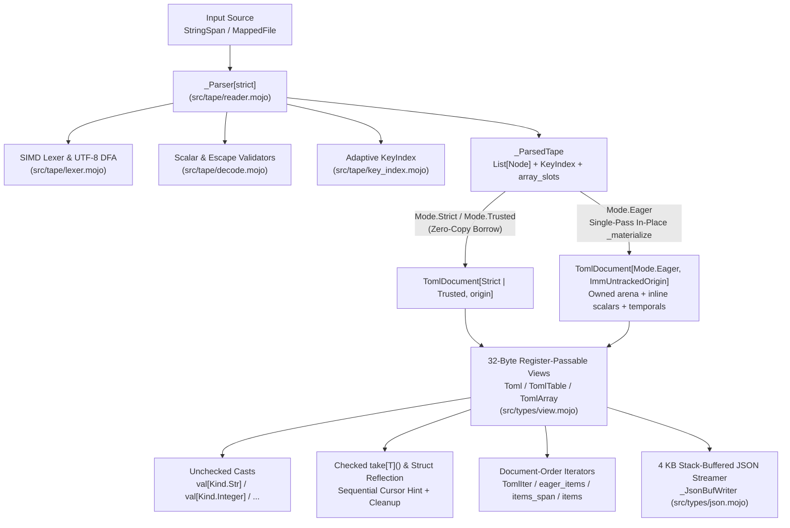

# `motoml` Architecture & Design Document

This document describes the architecture, memory layout, algorithms, API design, safety invariants, and performance characteristics of `motoml` — a zero-copy and arena-materialized TOML 1.1 parser, query engine, and compile-time reflection library for Mojo.

---

## 1. Design Goals & Invariants

1. **Full TOML 1.1 Specification Compliance**: Pass all 712 official `toml-test` 1.1.0 test cases (218 valid + 494 invalid) in both `Mode.Strict` and `Mode.Eager`, and all 218 valid cases in `Mode.Trusted`, with byte-for-byte identical JSON serialization across all three modes.
2. **Single Parser, Three Execution Modes**: One shared flat-tape parser (`src/tape/`) backs all modes via compile-time specialization (`strict: Bool`), eliminating parser drift:
   - **`Mode.Strict` (default)**: Zero-copy borrowing over the input `StringSpan` / `MappedFile` with full parse-time UTF-8, lexical, structural, duplicate-key, and scalar range validation.
   - **`Mode.Eager`**: Runs `Mode.Strict` validation and materializes all strings, keys, scalars, arrays, and temporals in place into compact owned storage with zero lifetime dependency on the input buffer.
   - **`Mode.Trusted`**: Zero-copy borrowing skipping parse-time UTF-8, duplicate-key, and scalar range checks for maximum throughput on pre-validated inputs, validating scalars lazily on `take[T]()`.
3. **Cache-Dense Value Semantics**: Every tape `Node` is exactly **32 bytes** (two nodes per 64-byte L1 cache line), and every public view (`Toml`, `TomlTable`, `TomlArray`) is a **32-byte `TrivialRegisterPassable` value** passed directly in four 64-bit registers.
4. **Zero-Allocation Fast Paths with Full API Compatibility**: Borrowed UTF-8 spans (`Kind.Str`, `as_str()`, `take[StringSpan[origin]]()`, `items_span()`, `eager_items()`), stack-buffered `Writer` streaming (`write_string_to`, `write_key_to`, `_JsonBufWriter`), and small-table inline linear scans (`<= 8` entries) avoid heap allocations on hot paths while keeping all `String`-returning APIs (`Kind.String`, `take[String]()`, `items()`, `keys()`) 100% backwards compatible.
5. **Memory & Exception Safety**: Verified clean under LLVM AddressSanitizer (`--sanitize address`) combined with full Mojo runtime assertions (`-D ASSERT=all`) across all 712 `toml-test` fixtures, unit suites, and differential mutation fuzzing against Python's `tomllib`.

---

## 2. High-Level Architecture

### Module Layout (`src/`)

| Module | Responsibility |
|---|---|
| `src/__init__.mojo` | Public package re-exports (`parse_toml`, `Toml`, `Kind`, `Mode`, iterators, temporals) |
| `src/mode.mojo` | Compile-time-foldable `Mode` enum (`Strict`, `Eager`, `Trusted`) |
| `src/parser.mojo` | `try_parse_toml`, `parse_toml`, `parse_toml_file`, `TomlFile`, `toml_to_tagged_json` |
| `src/result.mojo` | Linear `Result[T, E]` (comptime-friendly) and register-passable `ScalarResult[T]` |
| `src/mmap_file.mojo` | POSIX `mmap` read-only file handle (`MappedFile`) |
| `src/tape/node.mojo` | 32-byte `Node`, `NodeKind`, `NodeFlags`, and `KeySeg` |
| `src/tape/lexer.mojo` | 256-byte character-class LUT, SIMD UTF-8 DFA, comment/whitespace skippers, scalar classifier |
| `src/tape/decode.mojo` | SWAR integer decoder, Clinger `Float64` decoder, SIMD string unescaping to buffer/writer |
| `src/tape/key_index.mojo` | Adaptive two-tier key lookup & duplicate detector (`SMALL_TABLE_LIMIT = 8` + flat hash table) |
| `src/tape/reader.mojo` | `_Parser[strict]` stateful flat-tape builder and cold `line:col` error formatter |
| `src/types/kind.mojo` | Runtime `KindTag` enum and compile-time `_Kind[id]` tokens (`Kind.String`, `Kind.Str`, ...) |
| `src/types/tempo.mojo` | RFC 3339 / TOML 1.1 `Date`, nanosecond `Time`, `Offset`, `DateTime`, and 2-digit LUT formatters |
| `src/types/store.mojo` | Document backing `_Store` (`KeyIndex`, `arena`, `array_slots`, `temporals`) |
| `src/types/document.mojo` | Owning `TomlDocument[mode, origin]` and single-pass in-place `_materialize` |
| `src/types/view.mojo` | 32-byte `Toml`, `TomlTable`, `TomlArray`, iterators, and `take[T]()` reflection engine |
| `src/types/reflection.mojo` | Trait helpers and partial-struct destruction (`_destroy_partial_struct`) |
| `src/types/one_of.mojo` | Reflectable `OneOf[*Ts]` wrapper over `Variant[*Ts]` |
| `src/types/json.mojo` | 4 KB stack-buffered `_JsonBufWriter` and SIMD JSON escaping |

---

## 3. Memory Layout & Core Data Structures

### 3.1 `Mode` (`src/mode.mojo`)

`Mode` is implemented as an `EnumLike`, `TrivialRegisterPassable` struct wrapping `var _value: Int` (`0 = Strict`, `1 = Eager`, `2 = Trusted`) with `@always_inline("builtin")` constructors and comparisons. This allows Mojo's `where`-clause constraint solver (`where mode != Mode.Eager` vs `where mode == Mode.Eager`) to constant-fold mode equality during overload resolution so `parse_toml(src)` returns `TomlDocument[Mode.Strict, src.origin]` while `parse_toml[Mode.Eager](src)` returns an owned `TomlDocument[Mode.Eager, ImmUntrackedOrigin]`.

### 3.2 32-Byte Tape `Node` (`src/tape/node.mojo`)

Every TOML value (root table, headers, inline tables, arrays, array-of-tables elements, and scalars) is stored as a single 32-byte `Node` in a flat `List[Node]`:

| Byte Offset | Field | Type | Purpose in `Strict` / `Trusted` | Purpose in `Mode.Eager` |
|---:|---|---|---|---|
| `0` | `kind` | `NodeKind` (`UInt8`) | `Empty`, `String`, `Integer`, `Float`, `Boolean`, `Date`, `Time`, `DateTime`, `Array`, `Table`, `NaN`, `Inf` | Same |
| `1` | `flags` | `UInt8` | Structural & lexical `NodeFlags` | `CONTIGUOUS`, `SLOTTED`, `INDEXED`, etc. |
| `2` | `key_flags` | `UInt8` | `NodeFlags.HAS_ESCAPE` if key contains `\` | `0` (all keys unescaped in place) |
| `3` | `key_tag` | `UInt8` | First raw byte of key (1-cycle filter) | First unescaped byte of key |
| `4..7` | `start` | `UInt32` | Source byte offset (or `array_slots` start if `SLOTTED`) | Arena offset (`String`), lo32 of `Int64`/`Float64`, packed `Y<<16\|M<<8\|D` (`Date`), `0/1` (`Bool`), `temporals` idx (`Time`/`DateTime`), or `array_slots` start |
| `8..11` | `len` | `UInt32` | Raw byte length (or child count for `Table`/`Array`) | Decoded UTF-8 length (`String`), hi32 of `Int64`/`Float64`, or child count (`Table`/`Array`) |
| `12..15` | `key_start` | `UInt32` | Source byte offset of node's key | Arena byte offset of unescaped key |
| `16..19` | `key_len` | `UInt32` | Raw byte length of node's key | Decoded UTF-8 byte length of key |
| `20..23` | `first_child` | `UInt32` | Index of first child (`NO_NODE` if empty) | Same |
| `24..27` | `last_child` | `UInt32` | Index of last child (`NO_NODE` if empty; O(1) append) | Same |
| `28..31` | `next_sibling` | `UInt32` | Intrusive sibling link in document order | Same |

Packing inline 64-bit scalars (`Int64`, `Float64`), `Bool`, and `Date` directly into `(start, len)` in `Mode.Eager` eliminates separate side-arrays for numbers and dates while keeping `sizeof[Node]() == 32`.

#### `NodeFlags` Bit Assignments

- **Container state**: `DEFINED (0x01)`, `IMPLICIT (0x02)`, `INLINE (0x04)`, `DOTTED (0x08)`, `ARRAY_OF_TABLES (0x10)`, `INDEXED (0x20)`, `CONTIGUOUS (0x40)`, `SLOTTED (0x80)`.
- **Scalar/String state** (disjoint from container `NodeKind`s): `HAS_ESCAPE (0x01)`, `MULTILINE (0x02)`, `LITERAL (0x04)`, `CANONICAL (0x08)`.

### 3.3 Adaptive Two-Tier `KeyIndex` (`src/tape/key_index.mojo`)

Real-world TOML files (such as `Cargo.lock`, `pyproject.toml`, and nested configuration files) are dominated by hundreds or thousands of small tables (`<= 8` keys per `[section]` or `[[package]]`), alongside occasional flat tables with thousands of keys. Building a hash table entry for every key in small tables wastes both memory bandwidth and hash probes, while purely linear scans degrade to $O(N^2)$ on large tables.

`KeyIndex` resolves both regimes with an adaptive two-tier threshold (`SMALL_TABLE_LIMIT = 8`):

1. **Tier 1 — Unindexed Small Tables (`len <= 8`, `NodeFlags.INDEXED == 0`)**:
   - **Zero heap allocations**: `KeyIndex.slots` stays completely unallocated (`capacity == 0`) if no table in the document exceeds 8 entries.
   - **Tag-filtered word-wise sibling scan**: Lookups and duplicate checks walk `first_child -> next_sibling` (at most 8 nodes), filtering candidates in two instructions via `cnode.key_len == key_n and cnode.key_tag == first_byte` before calling `_bytes_equal` (unaligned overlapping `UInt32` loads for `4..8` bytes; `UInt64` word loop + overlapping tail load for `> 8` bytes).
2. **Tier 2 — Lazy Promotion to Open-Addressing Hash Table (`len > 8`, `NodeFlags.INDEXED != 0`)**:
   - On inserting the 9th child into a table, `_promote_table` allocates `slots` (if not yet initialized, sized to a power of two around `doc_len // 12` capped at `262,144` slots) and hashes the existing 8 children plus the new child into 16-byte `KeySlot`s:
     - `parent: UInt32`, `node_idx: UInt32`, `hash_val: UInt32`, `key_len_flags: UInt32` (high bit `KEY_ESCAPE_BIT = 0x80000000` marks escaped keys).
   - **Load factor cap (`70%`)**: Keeping occupancy `<= 0.70` bounds expected linear-probing cluster length ($\frac{1}{2}(1 + (1-\alpha)^{-2}) \approx 6.0$ worst-case unsuccessful probe vs `14.7` at `81%`), sustaining high throughput on 10 MB+ multi-hundred-thousand-key documents.
   - **Zero-allocation escaped-key handling**: Escaped keys (`"a\nb"`, `"\u0061"`) are decoded into a 256-byte stack `Array[Byte, 256]` to compute their canonical unescaped hash (`compute_escaped_key_hash`) and byte equality (`_escaped_key_matches_bytes`), ensuring `"a"` and `"\u0061"` hash to the same bucket and compare equal without heap allocations.

### 3.4 Pointer-Passed Stateful Engines (`not RegisterPassable`)

In Mojo `1.3`, `List[T]`, `String`, and `Array[T, N]` conform to `RegisterPassable`, so structs composed of them implicitly become `RegisterPassable`. For large stateful engines (`_Parser` = ~160 bytes, `KeyIndex` = 48 bytes, `_JsonBufWriter` = ~4,112 bytes), implicit `RegisterPassable` causes non-inlined `mut self` calls (such as cold `_fail` paths, recursive container parsers, `_promote_table`, or `flush`) to copy `self` by value through stack `sret` slots and spill register-resident cursors.

Explicitly marking `_Parser`, `KeyIndex`, and `_JsonBufWriter` as `(Movable, not RegisterPassable)` forces memory-addressed pointer passing (`8` bytes in `x0` on ARM64) across all call boundaries while keeping hot fields in registers inside loops.

---

## 4. Parsing, Materialization, & Indexing Algorithms

### 4.1 SIMD UTF-8 Validation & Lexing (`src/tape/lexer.mojo`)

- **Two-Level UTF-8 Validator (`is_valid_utf8_fast`)**:
  - Scans 64-byte blocks (`4 x 16B` NEON loads ORed together). Pure-ASCII blocks (`< 0x80`) advance `i += 64` with a single branch.
  - When non-ASCII bytes appear, peels clean 16-byte ASCII sub-vectors before running the Keiser–Lemire 3-nibble lookup DFA (`_UTF8_LUT_LO`, `_UTF8_LUT_HI`, `_UTF8_LUT_C2` via hardware `vqtbl1q_u8` / `_dynamic_shuffle`) to validate arbitrary 2-, 3-, and 4-byte UTF-8 sequences (rejecting overlongs, surrogates `U+D800..U+DFFF`, and `> U+10FFFF`) in SIMD registers.
- **NEON `any(stop)` Gate Before `pack_bits`**:
  - On ARM64 NEON (which lacks x86 `pmovmskb`), `pack_bits` on `SIMD[DType.bool, 16]` lowers to horizontal pairwise adds. Gating every 16-byte string, comment, whitespace, and JSON escape loop with `if not any(stop): idx += 16; continue` compiles to 3 instructions (`umaxv.16b` + `fmov` + `cbz`) on clean 16-byte chunks, computing `pack_bits` + `count_trailing_zeros` only on the chunk containing a delimiter or escape.
- **Single-Pass Scalar Classifier (`scan_and_classify_scalar`)**:
  - Classifies integers, floats, `nan`/`inf`, booleans, dates, times, and datetimes in one pass over the token bytes:
    - 1-byte scalar fast path immediately classifies single-digit integers (`0..9`) with `pv = 2` (`NodeFlags.CANONICAL`) without entering the loop.
    - Sets `pv = 2` (`CANONICAL`) for clean decimal integers (`[+-]?([0]|[1-9][0-9]*)`, `<= 18` digits — guaranteed cannot overflow `Int64`) and clean decimal floats (`[+-]?([0]|[1-9][0-9]*)\.[0-9]+`), and `pv = 1` for exact `true`/`false`, bypassing redundant second-pass validation in `Mode.Strict`.

### 4.2 Single-Pass In-Place `Mode.Eager` Materializer (`src/types/document.mojo`)

`Mode.Eager` converts a `Strict`-validated `_ParsedTape` into a self-contained `TomlDocument[Mode.Eager]` in a single pass with **one arena allocation**:

1. **Streaming Bulk Copy**: Allocates `arena = List[Byte](capacity=src_len)` and copies `data` into `arena` with one `unsafe_memcpy` (~40 µs/MB on Apple Silicon).
2. **In-Place Disjoint Unescaping Invariant**:
   - Every node's key span `[key_start, key_start + key_len)` and string span `[start, start + len)` are pairwise disjoint slices of `data`.
   - Every valid TOML 1.1 escape sequence (`\"` 2->1B, `\n` 2->1B, `\xHH` 4->1..2B, `\uHHHH` 6->1..3B, `\UHHHHHHHH` 10->1..4B, multiline `\<ws>\n` >=2->0B) decodes to **strictly fewer** UTF-8 bytes than its raw representation.
   - Therefore, `_materialize` walks `nodes[0..n_nodes]` once: unescaped keys and strings already sit at their exact offsets in `arena` with zero work; escaped keys and strings decode directly from `src_ptr + offset` into `arena_ptr + offset` via `decode_string_to_buf_unchecked`, updating `key_len` / `key_tag` / `len` in place; numbers and dates pack into `(node.start, node.len)`; and `Time`/`DateTime` append to `temporals`.
   - If `any_escaped_key` was encountered, `KeyIndex` slots marked with `KEY_ESCAPE_BIT` have their `key_len_flags` refreshed to the unescaped `node.key_len` (their `hash_val` already stores the unescaped key hash from parse time!).

### 4.3 O(1) Array Indexing (`NodeFlags.CONTIGUOUS` & `NodeFlags.SLOTTED`)

Because `_Parser` appends nodes to `self.nodes` in monotonically increasing order, an array's direct children `[c_0, c_1, ..., c_{k-1}]` have indices `first_child == c_0 < c_1 < ... < c_{k-1} == last_child`. Whenever no child is a non-empty container (i.e., every flat array of scalars, strings, or empty containers):

$$\text{last\_child} - \text{first\_child} == \text{len} - 1 \implies c_i == \text{first\_child} + i$$

- **`NodeFlags.CONTIGUOUS`**: Set at the end of `_parse_array_node` (and `_finalize_aot_slots`) whenever `len <= 1` or `last_child - first_child == len - 1`. `arr[i]` resolves in **1 addition (`first_child + UInt32(i)`)** with **zero auxiliary memory** across `Strict`, `Trusted`, and `Eager`!
- **`NodeFlags.SLOTTED`**: Set when an array is non-contiguous (contains non-empty nested arrays/tables) and `len > 8` (or any non-contiguous array in `Mode.Eager`), storing child indices in `store.array_slots[node.start .. node.start + node.len]` for O(1) lookup. Non-contiguous lazy arrays with `<= 8` elements walk at most 7 sibling links with zero `array_slots` allocation.

### 4.4 SWAR & Clinger Scalar Codecs (`src/tape/decode.mojo`, `src/types/tempo.mojo`)

- **Integers**: Canonical decimal integers (`NodeFlags.CANONICAL`) skip sign/base/underscore branches and decode 4 or 8 ASCII digits in parallel via SWAR (`_parse_4d_swar`, `_parse_8d_swar`).
- **Floats**: Canonical and scientific floats with `<= 15` significant digits and `|effective_exp| <= 22` compute `Float64(acc) * _pow10(e)` or `Float64(acc) / _pow10(-e)` — guaranteed IEEE-754 round-to-nearest-even exact by Clinger's theorem because both `Float64(acc)` (`< 2^53`) and `10^k` (`0 <= k <= 22`) are exact in binary64. Numbers exceeding 15 significant digits or extreme exponents fall back to `atof`.
- **Temporals**: Fixed-offset arithmetic decodes `YYYY-MM-DD` and `HH:MM[:SS[.nanos]]` directly from bytes, and `_DIGIT_PAIRS` (200-byte `"0001...99"` LUT) formats `Date`, `Time`, `DateTime`, and JSON integers directly into stack buffers without intermediate `String` allocations.

---

## 5. Stack-Buffered JSON Streaming (`src/types/json.mojo`)

`doc.to_json(writer)` wraps the caller's `Writer` in `_JsonBufWriter[W]` (4 KB stack `Array[Byte, 4096]`, `not RegisterPassable`):

1. **Compile-Time Literal Stores (`put_lit[s: StaticString]()`)**: Taking JSON structural tags (`'{"type": "string", "value": "'`, `'": '`, `'"}'`) as `comptime` parameters makes `N = s.byte_length()` a compile-time constant, allowing LLVM to lower every tag write into 1–2 unaligned NEON/GPR store instructions instead of variable-length `memcpy` dispatch.
2. **Single-Pass Escaped String Streaming (`_put_toml_string_as_json_impl`)**: Unescapes TOML 1.1 escapes (`\xHH`, `\uHHHH`, `\UHHHHHHHH`, multiline `\<ws>\n`) and re-escapes JSON control/quote characters directly into the 4 KB stack buffer in one pass without allocating an intermediate `String`.
3. **Exact Shortest-Roundtrip Float Passthrough (`_is_exact_canonical_float_repr`)**: In `Mode.Strict`, canonical floats `[+-]?[1-9][0-9]*\.[0-9]+` (or `0.[1-9]...` / `0.0`) with `<= 15` digits and no trailing fractional zero after `.d` are provably byte-for-byte identical to `Float64.write_to` (Dragonbox/Ryu) and copy directly from source bytes in ~2 ns; scientific notation (`10e2` -> `"1000.0"`) and trailing-zero floats (`5.50` -> `"5.5"`) format via `decode_float_unchecked` so `Mode.Strict`, `Mode.Eager`, and `Mode.Trusted` emit **100% identical JSON strings**.

---

## 6. Compile-Time Reflection (`take[T]()`)

`Toml.take[T]()` uses Mojo's compile-time `reflect[T]` primitives to deserialize tables, arrays, and scalars directly into typed Mojo values:

- **Sequential Sibling Cursor Hint (`_get_field[NAME](hint_idx)`)**:
  - `_take_struct[T]` initializes `var hint_idx = self._node().first_child`.
  - For each reflected struct field `NAME` (with compile-time `NAME_LEN = NAME.byte_length()`), `_get_field` first inspects `nodes_ptr[hint_idx]`: if unescaped and `key_len == NAME_LEN` and `_bytes_equal(..., NAME_LEN)` (which constant-folds into a single 32-bit/64-bit load+compare for typical field names), it advances `hint_idx = cnode.next_sibling` and returns in **O(1) with zero hashing**.
  - If an `Optional` field is absent in the TOML table, `find_by_bytes` returns `NO_NODE` *without* clobbering `hint_idx`, so `hint_idx` remains aligned on the very next in-order field! If fields appear out of order, `find_by_bytes` locates the field and re-synchronizes `hint_idx = found.next_sibling`.
- **Exception-Safe Partial Cleanup**: Struct fields are written into `MaybeUninit[T]`. If field `fi` fails validation or is missing, `_destroy_partial_struct[T](storage, fi)` destroys fields `0 .. fi - 1` in reverse order before propagating the `Error`, preventing memory leaks on partially constructed structs or backtracking `OneOf` / `__union` / `Variant` arms.

---

## 7. API Improvements & Backwards Compatibility Layer

Where original APIs forced heap allocations (`String` copies on string reads, struct fields, and table key iteration) or restricted numeric struct fields to `Int`/`Float64`, new zero-copy and fixed-width APIs were added alongside the preserved compatibility surface:

| Use Case | Backwards-Compatible API (Preserved 100%) | High-Performance / Zero-Allocation API (Added) | Benefit |
|---|---|---|---|
| Unchecked string cast | `val[Kind.String] -> String` | `val[Kind.Str] -> StringSpan[origin]` `val.as_str() -> StringSpan[origin]` (`Eager`) | Zero heap allocation; borrows `data` (lazy unescaped/literal) or `arena` (all `Eager` strings) |
| Checked string & struct reflection | `val.take[String]() -> String` `struct S: var host: String` | `val.take[StringSpan[origin]]()` `struct S[o]: var host: StringSpan[o]` | Zero-copy struct reflection with UTF-8 validation in `Trusted` mode |
| Streaming escaped strings/keys | `w.write(val.take[String]())` | `val.write_string_to(w)` `val.write_key_to(w)` | Decodes escapes via a 512 B stack buffer directly into `w` with zero `String` allocation |
| Node key access | *(only via `items()` / `keys()`)* | `val.key() -> String` `val.key_str() -> StringSpan[origin]` (`Eager`) | Direct O(1) key access on any `Toml` child view |
| Table `(key, value)` iteration | `tbl.items() -> TomlItemIter` *(yields `(String, Toml)`)* | `tbl.items_span() -> TomlSpanItemIter` `tbl.eager_items() -> TomlStrItemIter` | Eliminates per-entry `String` allocation during table iteration |
| Table key iteration | `tbl.keys() -> TomlKeyIter` *(yields `String`)* | `tbl.keys_span() -> TomlSpanKeyIter` `tbl.eager_keys() -> TomlStrKeyIter` | Zero-allocation borrowed `StringSpan` key iteration |
| Compact numeric fields in `take[T]()` | `Int`, `Float64` | `Int8`, `Int16`, `Int32`, `Int64`, `UInt`, `UInt8`, `UInt16`, `UInt32`, `UInt64`, `Float32` | Checked range-validated extraction into compact struct layouts |
| Lazy array indexing `arr[i]` | `arr[i] -> Toml` *(was O(i) walk)* | `arr[i] -> Toml` *(now O(1) via `CONTIGUOUS` / `SLOTTED`)* | Same API, **>300x faster** on 2,000-element lazy arrays |

---

## 8. Correctness, Sanitizer, & Fuzzing Verification

1. **Official `toml-test` 1.1.0 Compliance (`tests/test_toml_suite.mojo`)**:
   - `Mode.Strict`: **712 / 712 passed** (218 valid + 494 invalid).
   - `Mode.Eager`: **712 / 712 passed** (218 valid + 494 invalid).
   - `Mode.Trusted`: **218 / 218 valid passed**.
2. **Cross-Mode Byte-for-Byte Parity (`tests/test_parsing.mojo`)**:
   - Verifies exact string equality of `toml_to_tagged_json` across `Strict`, `Eager`, and `Trusted` on all 218 valid spec fixtures, plus `TomlFile` memory-mapped lifetime tests and `line:col` diagnostic checks.
3. **Strict Spec Boundary Suite (`tests/test_strict_spec.mojo`)**:
   - IEEE-754 special floats/overflow, illegal escapes (`\0`, surrogates, bare CR), integer `Int64` min/max cutoffs, leap-year/timezone boundaries, table redefinition/dotted-key conflicts, 512-level nesting depth cap, and SIMD 64B/16B UTF-8 chunk boundaries.
4. **AddressSanitizer + Full Assertions (`--sanitize address -D ASSERT=all`)**:
   - Built and executed with `libclang_rt.asan_osx_dynamic.dylib` (`detect_stack_use_after_return=1:check_initialization_order=1:strict_init_order=1:abort_on_error=1`) and `-D ASSERT=all` across:
     - `tests/asan_parser.mojo` (all 712 `toml-test` files in `Strict` and `Eager`)
     - `tests/test_parsing.mojo`, `tests/test_strict_spec.mojo`, `tests/test_views_and_types.mojo`, `tests/test_reflection.mojo`, `tests/test_comptime.mojo`
     - `tests/lazy_to_json.mojo` driven by `tests/fuzz_diff.py` (`300` valid random seeds x 3 modes + `300` invalid mutations x 2 modes against Python `tomllib`).

---

## 9. Performance Summary (Apple Silicon, Mojo `1.3`)

### 9.1 1 MB Corpora (`bench_lazy.mojo`, 15-run median MB/s)

| Corpus | Set | Baseline Strict | Final Strict | Baseline Trusted | Final Trusted | Baseline Eager | Final Eager |
|---|---|---:|---:|---:|---:|---:|---:|
| `strings_plain` | Tuned | 2,451 | **2,457** | 2,941 | **3,049** (+4%) | 2,128 | **2,257** (+6%) |
| `strings_escaped` | Tuned | 650 | **694** (+7%) | 940 | **889** | 382 | **403** (+6%) |
| `ints_floats` | Tuned | 621 | **605** | 661 | **622** | 404 | **426** (+5%) |
| `dates` | Tuned | 663 | **734** (+11%) | 704 | **752** (+7%) | 545 | **608** (+12%) |
| `many_tables` | Tuned | 569 | **810** (**+42%**) | 596 | **867** (**+45%**) | 499 | **698** (**+40%**) |
| `array_of_tables` | Tuned | 842 | **833** | 937 | **1,052** (**+12%**) | 682 | **749** (**+10%**) |
| `inline_nested` | Tuned | 412 | **556** (**+35%**) | 451 | **614** (**+36%**) | 339 | **467** (**+38%**) |
| `mixed` | Tuned | 600 | **760** (**+27%**) | 734 | **797** (+9%) | 492 | **570** (**+16%**) |
| `huge_table` | Tuned | 788 | **759** | 799 | **801** | 670 | **683** (+2%) |
| `dotted_keys` | Tuned | 483 | **524** (+8%) | 479 | **538** (**+12%**) | 425 | **482** (**+13%**) |
| `realworld_lock` | Hold-Out | 1,600 | **1,527** | 1,832 | **1,752** | 1,250 | **1,342** (+7%) |
| `realworld_config` | Hold-Out | 907 | **1,027** (**+13%**) | 1,039 | **1,178** (**+13%**) | 684 | **791** (**+16%**) |
| `toml_test_concat` | Hold-Out | 681 | **867** (**+27%**) | 782 | **1,057** (**+35%**) | 474 | **661** (**+39%**) |

### 9.2 Generic, JSON Streaming (`String` Writer), Access, Reflection, & 10 MB Scaling

| Benchmark | Metric | Baseline | Final | Speedup |
|---|---|---:|---:|---:|
| `utf8_heavy` (`Strict` / `Eager`) | Max MB/s | 2,181 / 2,004 | **2,582 / 2,373** | **+18% / +18%** |
| `utf8_heavy` (`Parse + to_json(String)`) | Max MB/s | 495 | **1,317** | **2.66x** |
| `multiline_comments` (`Parse + to_json(String)`) | Max MB/s | 256 | **759** | **2.96x** |
| `4k-key lookup + decode` (`Strict` / `Eager`) | ns / entry | 21.25 / 14.25 | **12.75 / 8.50** | **1.67x / 1.68x** |
| `4k child iteration + decode` (`Strict` / `Eager`) | ns / entry | 3.75 / 2.00 | **2.75 / 2.00** | **1.36x / 1.00x** |
| `2k array index` (`Lazy arr[i]` / `Eager arr[i]`) | ns / elem | ~1,000 / 0.50 | **3.00 / 0.50** | **>300x / 1.00x** |
| `Struct reflection (parse + take[Struct])` (`Strict` / `Eager`) | ns / call | 260 / 340 | **140 / 210** | **1.86x / 1.62x** |
| `10 MB strings_plain` (`Eager` / `Strict`) | MB/s | 308 / 1,462 | **421 / 1,498** | **+37% / +2%** |
| `10 MB many_tables` (`Eager` / `Strict`) | MB/s | 165 / 306 | **235 / 546** | **+43% / +79%** |
| `10 MB inline_nested` (`Eager` / `Strict`) | MB/s | 109 / 206 | **153 / 374** | **+40% / +82%** |
| `10 MB mixed` (`Eager` / `Strict`) | MB/s | 197 / 371 | **237 / 495** | **+21% / +33%** |
